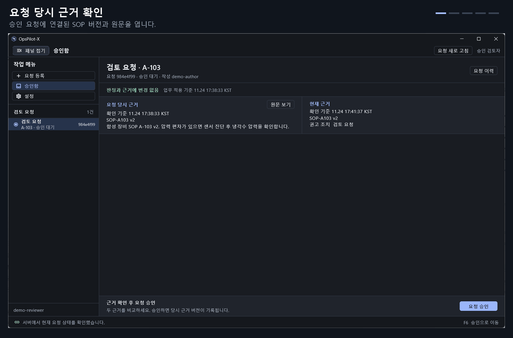

# OpsPilot-X

**운영 규정의 권한·버전·충돌을 확인하고, 독립 승인으로 확정한 조치를 PDF와 영수증으로 남기는 AI 운영 콘솔입니다.** IT 운영팀이 “지금 이 조치를 해도 되는가, 당시 근거는 무엇이었는가”를 한 흐름에서 검토할 수 있습니다.

[Windows 다운로드](https://github.com/KIMJINWOO0548/OpsPilot/releases/latest) · [90초 시연](docs/PORTFOLIO_DEMO.md) · [합성 승인 PDF](docs/portfolio/approved-report-sample.pdf) · [Windows 실행](#실행하기) · [근거 검증 계약](docs/architecture/EIE_CONTRACT.md)



*Windows 포터블 앱에서 합성 요청 한 건을 검토하고 복구한 화면을 15초로 편집했습니다.*

## 무엇을 할 수 있나요?

1. **근거 조사와 요청 등록.** 동일한 업무 적용 시점을 기준으로 두 관측 시점의 규정·인용을 비교합니다. 권한과 날짜가 맞는 자료에서만 로컬 모델이 조치와 인용을 제안합니다. 근거가 부족하거나 승인된 규정이 충돌하면 요청을 잠급니다.
2. **독립 검토와 인계.** 다른 검토자가 요청 당시 원문과 현재 근거를 비교합니다. 담당자가 바뀌면 사유를 기록하고 요청의 승인 버전과 팀 권한을 다시 확인합니다.
3. **승인 증빙과 복구.** 승인한 조치와 근거를 PDF로 남깁니다. 응답이 끊겨도 기존 영수증을 확인해 결과를 재사용합니다.

## 실행하기

| 경로 | 시작 방법 |
| --- | --- |
| Windows 앱 | Windows x64 포터블 ZIP을 새 폴더에 풀고 `OpsPilot-X.cmd`를 실행합니다. 합성 데모 계정은 첫 실행에서 만들어지며 명령 창에 계정 파일 위치가 표시됩니다. [운영 안내](desktop/portfolio/README.ko.md) · [번들 만들기](desktop/flutter/README.md) |
| 소스에서 즉시 확인 | Python 3.12로 가상 환경을 만들고 아래 스모크를 실행합니다. 합성 요청 → 독립 승인 → 응답 유실 → 영수증 복구를 외부 API 키나 모델 다운로드 없이 확인합니다. |
| 브라우저 콘솔 | FastAPI·React를 함께 실행합니다. 개발용 데모와 Docker 실행 절차가 있습니다. [실행 가이드](docs/DEPLOYMENT.md) |

```powershell
py -3.12 -m venv .venv
.\.venv\Scripts\python.exe -m pip install -c requirements-runtime.lock -e ".[dev]"
.\.venv\Scripts\python.exe scripts\smoke_demo.py
```

## 어떻게 동작하나요?

```text
세션·조직·팀 → SQLite 문서 권한과 관측 시점 선필터
              → EIE 유효 기간·충돌 판정 → BM25 + 임베딩 → 인용 검증
              → 독립 승인 → PDF + 영수증 → 응답 유실 복구
```

FastAPI가 권한, 문서 버전, 승인 상태를 결정합니다. Flutter Windows 작업대와 React 콘솔은 같은 API를 사용합니다. 로컬 Qwen은 판정을 통과한 근거에서 인용을 제안합니다. 문서 원문과 위치를 대조한 뒤 요청에 연결합니다. [Hybrid RAG 설계](docs/decisions/ADR-006-LOCAL-HYBRID-DRAFTS.md) · [승인과 인계](docs/decisions/ADR-005-DRAFT-HANDOVER.md)

## 로컬 모델로 비교한 합성 정책 40건

| 측정 항목 | 단순 RAG | OpsPilot |
| --- | ---: | ---: |
| 권한 밖 자료가 응답에 포함 | 7/8 | 0/8 |
| 시간이나 대체 관계가 맞지 않는 근거 사용 | 8/14 | 0/14 |
| 충돌하는 SOP에서 초안 차단 | 0/6 | 6/6 |
| 적격 사례에서 정답과 근거가 일치한 초안 | 15/23 | 23/23 |

개발 24건과 문서 계열을 분리한 홀드아웃 16건의 합성 예비 실험입니다. 실험 조건, 사례별 출력과 한계를 공개합니다. [결과](evaluation/pilot40-results.ko.md) · [사례별 데이터](evaluation/pilot40-results.json) · [재실행](evaluation/pilot40.ko.md)

실제 Windows 승인함에서 31건 중 승인 원문을 열고, 검토 인계 후 같은 영수증과 PDF를 복구했습니다. [시연과 검증 범위](docs/PORTFOLIO_DEMO.md)

이 버전의 배포 대상은 Windows 단일 PC의 관리형 작업공간과 로컬 데모입니다. 공용 서버 운영, 사내 SSO, 다중 사용자 부하, 공식 외부 벤치마크는 별도의 검증 범위입니다. [운영·보안 조건](docs/safety/THREAT_MODEL.md)
