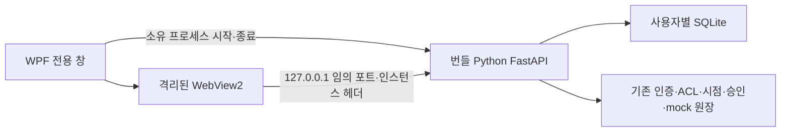

# OpsPilot-X Windows Desktop 설계

상태: 사용자 검토 후 설치형 패키지 필수로 수정(2026-10-27). Windows 우선과 설치형 요구는 사용자가 선택했다. 기존 권고 구조에 설치형 산출물을 포함해 구현한다.

## 목적과 범위

대기업 AI/DT·AI 백엔드 포트폴리오를 위해 브라우저/터미널을 따로 열지 않고 실행 파일에서 로그인→근거 조사→시점 이력→독립 승인→mock 유실 복구까지 수행한다. Windows 11 x64를 첫 대상으로 한다. 데스크톱 전환은 G0/G1 연구 수용이나 실제 모델 실험 완료를 뜻하지 않는다.

완료 산출물은 전용 Windows 창, 앱이 관리하는 로컬 API, 사용자별 데이터 경로, 최초 계정 설정, 오류/재시도 화면, 실행 가능한 portable ZIP·설치형 Setup.exe와 재현 빌드·검증 기록이다. 실행에 Python·Node·Docker 개발 설치가 필요 없도록 기존 로컬 런타임을 선별 패키징한다. WebView2 Evergreen Runtime은 선행 조건이며 없으면 안내한다. 이번에는 자동 다운로드/업데이트·Store 업로드·코드 서명·공개 배포를 하지 않는다. 실제 다른 PC 검증 전에는 로컬 preview로 표시한다.

## 대안

| 방식 | 이점 | 비용과 판단 |
|---|---|---|
| .NET 10 WPF + WebView2 | 기존 React/인증/정책 보존, 설치된 .NET·캐시 SDK 활용 | Windows 전용. **권고** |
| WPF 네이티브 UI 재작성 | 모든 화면을 네이티브로 구성 | 기존 UI·접근성·회귀 재작성 비용. 이번에는 보류 |
| Electron / Tauri | 다중 플랫폼 패키징 경로 | 새 런타임/도구체인 설치가 필요. Windows 우선에서 보류 |

## 요구사항과 UI

- Windows 기본 제목 표시줄/최소화/최대화/종료, 1200×820 기본·960×640 최소 창. 기존 navy/teal·시스템 폰트·조사/이력/승인 화면을 재사용한다.
- 시작 상태: 구성 검사→로컬 서비스 시작→WebView 로딩. 오류에는 원인 범주·재시도·종료를 제공한다. 무한 로딩/자동 실행 재시도를 하지 않는다.
- 첫 실행: 기본 계정은 없다. 네이티브 설정 화면에서 engineer와 approver의 계정명·새 비밀번호·비밀번호 확인을 사용자가 지정한다. 역할·합성 workspace·mock 경계를 화면에 명시한다. 취소하면 계정을 만들지 않는다. 비밀번호는 stdin으로만 전달하고 인수/URL/로그에 남기지 않는다. 기존 DB가 비어 있지 않으면 초기화 거부, 두 계정은 단일 트랜잭션으로 생성한다. 자동 로그인은 하지 않는다.
- 데이터는 `%LocalAppData%/OpsPilot-X/`의 DB·WebView profile로 구분하고 설치 폴더에 쓰지 않는다. 앱 종료/버전 교체/패키지 삭제가 DB를 지우지 않는다. 저장소/기존 Docker volume은 자동 이관하지 않는다.
- 단일 인스턴스 잠금, 자식 API 종료 감시, 부모 종료 시 Job Object로 자식만 정리한다. 앱의 오류 복구가 승인 작업을 자동 재실행하지 않는다.

## 구조와 신뢰 경계

- .NET 10 WPF와 캐시된 `Microsoft.Web.WebView2 1.0.4258.31`만 사용한다. 새 패키지/전역 설정 설치 없이 offline restore/publish를 시도한다. 캐시 부족은 숨기지 않고 필요한 범위를 제시한다.
- Python은 `127.0.0.1:0`에 실제 소켓을 바인딩한 후 pipe로 주소를 알린다. 예약 후 닫는 포트 경합을 만들지 않는다. 호스트 생성 임의 토큰을 자식 stdin 초기 구성으로 전달한다. readiness는 토큰/포트 구조를 검사하고 해당 토큰의 health로 확인한다.
- desktop 전용 ASGI 경계는 모든 요청에서 정확한 Host/port와 인스턴스 헤더를 확인한다. 이 토큰은 UI JavaScript/URL에 노출하지 않고 WebView 요청에만 삽입한다. 기존 session·CSRF·principal·SQL ACL은 그대로 적용한다. proxy header는 신뢰하지 않는다. 일반 웹 모드에 desktop 초기 설정 API를 만들지 않는다.
- WebView는 정확한 자체 origin만 허용한다. 외부 탐색/프레임/하위 리소스·새 창·다운로드·권한·외부 URI scheme을 차단한다. host object·JS native bridge·remote debugging은 노출하지 않는다. profile 경로는 전용이며 시작 시 과거 세션 cookie를 지운다.
- DB 관리자/같은 Windows 사용자에 의한 프로세스 메모리·파일 변조까지 방어한다고 주장하지 않는다. 로컬 두 계정 시연은 실제 독립 사람 검토의 증거가 아니다.

## 패키징·수명주기

허용 목록으로 Python 실행 파일·DLL·stdlib, 기존 runtime dependency와 dist-info/LICENSE, 프로젝트 Python 소스/fixture, 빌드 UI, .NET self-contained host를 모은다. venv 전체·개발 DB·`.local`·쿠키·비밀번호·외부 데이터는 포함하지 않는다. Python PSF·WebView2·.NET 및 포함 dependency 고지/버전·파일 hash를 보존한다. CPython의 선별 복사가 독립 실행하는지는 배포 폴더에서 검증한다.

첫 릴리스는 unsigned portable ZIP과 사용자별 Setup.exe다. 설치기는 번들 payload를 검증하고 `%LocalAppData%/Programs/OpsPilot-X/<version>/`에 설치하며 시작 메뉴 바로가기를 만든다. 설치 시 명시적 버튼을 누르고 관리자 권한/서비스/자동 시작/외부 다운로드를 요구하지 않는다. 기존 버전은 덮어쓰지 않고 새 버전 설치가 완성된 뒤 바로가기를 전환한다. 같은 버전이 이미 있으면 재설치로 덮어쓰지 않고 안내한다. 새 버전도 별도 사용자 데이터 경로를 유지한다.

앱 제거는 설치기가 소유한 정확한 버전 경로·바로가기만 확인해 제거하고 업무 DB·profile은 유지한다. 경로 순회·payload hash 불일치·재분석 지점은 거부한다. 실제 설치/제거 검증은 임시 sandbox 경로와 테스트 바로가기에서 수행하고 실제 Windows 프로그램 경로/레지스트리는 변경하지 않는다. 서명·MSIX·자동 업데이트는 이후 별도 단위다. 공개 재배포 전 저장소 자체 라이선스·완전한 고지·서명 정책을 확정한다.

## 구현 단위와 수용 기준

1. Python desktop 경계: 잘못된 Host/토큰·초기 설정 재진입·부분 계정 생성 거부 테스트를 먼저 작성하고 정상·거부를 검증한다. 일반 웹 동작 보존.
2. WPF 호스트: 구성/주소 검증·프로세스 종료·탐색 허용 목록의 실패/정상 self-check, 실제 창의 시작/계정 설정/로그인/오류 표시를 확인한다.
3. 패키징: offline build·선별 복사·고지·hash·ZIP·Setup.exe. 임시 경로의 설치/재설치 거부/변조·경로 순회 거부/제거 후 DB 보존을 검사한다. 원래 개발 경로/PATH/PYTHONPATH에 의존하지 않는 공백·한글 배포 경로에서 실행한다.
4. 실제 업무 UI/HTTP: 미인증401·actor 위조/CSRF/ACL·작성자 승인 거부·독립 승인·미승인 write0·mock 유실/동일 영수증 복구, 충돌/과거 차단.
5. 정상/강제 부모 종료 후 소유 API listener/orphan 없음, 취소·기존 DB·버전 교체 데이터 보존. Windows 전체 pytest/두 smoke와 새 경계 테스트·frontend build를 기록한다. 실패를 제거하거나 skip하지 않는다.

2026-10-27 baseline: Windows 133개 중118 passed/2 failures/13 errors, smoke exit1, 합성 eval8/8 exit0. 현재 커널 부팅은10/26으로 관측돼 과거 재부팅 시각 불일치를 최신 원인으로 반복하지 않는다. WinError10014 원인은 미해결이다. 네이티브 앱·검증이 실패하면 portable release 수용을 막고 원인/다음 작업을 기록한다.

## 위험과 후속

R1 중복 연구, R3 누수, R4 과도한 보류, R5 benchmark 부적합은 기존 G0/G1 계획을 유지한다. R2 범위 확대는 사용자가 요청한 desktop 제품화로 한정한다. LLM/외부 쓰기/새 ML/노드 편집기를 추가하지 않는다. 외부 업로드·유료 서비스·서명 인증서·프로덕션 계정 변경은 별도 승인 범위다.

공식 근거: [WebView2 보안](https://learn.microsoft.com/microsoft-edge/webview2/concepts/security), [사용자 데이터](https://learn.microsoft.com/microsoft-edge/webview2/concepts/user-data-folder), [배포 방식](https://learn.microsoft.com/microsoft-edge/webview2/concepts/distribution), [Python Windows 배포](https://docs.python.org/3.12/using/windows.html). Microsoft Learn·Context7으로 전용 profile/탐색 차단/런타임 조건을 확인했다. 보안 기능 비활성화 예시는 채택하지 않는다.
